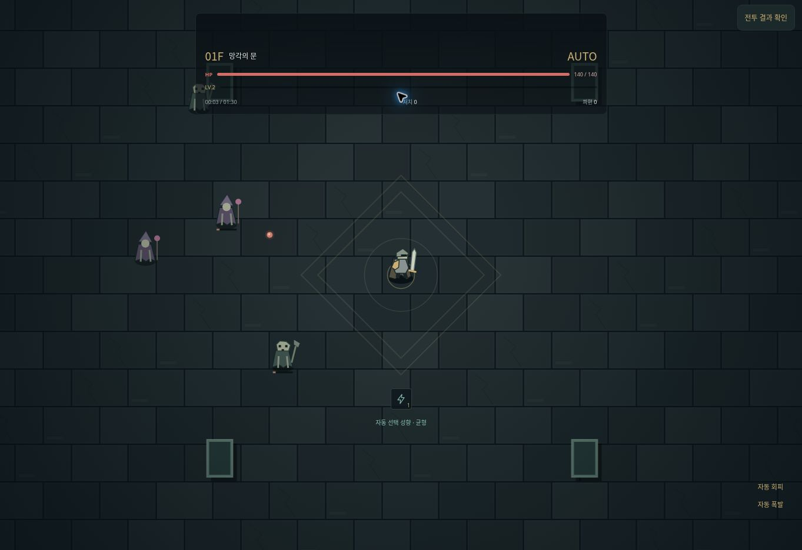

# 배포본 브라우저 점검 — 2026-10-14 22:32~22:35 KST

대상: https://jflakeee.github.io/towerofbabel/
배포 기준: PR #9, main 1ce62ad5d63f109bdf8cdfa5350a2241550461f7.
환경: 클라우드 Chrome, 데스크톱 화면. 새 테스트 프로필의 기본 기사·0파편·1층으로 점검했다. 실제 iOS/Android 또는 모바일 에뮬레이션 검증이 아니다.

| 경로 | 화면 관찰 결과 |
| --- | --- |
| 투기장 안내 | 정복 기록 없음·기본 난도·일반, 무료·무보상 안내 표시 |
| 투기장 시작 | 보스 2체·각 체력·5분 제한·파편 미지급 표시, Canvas 렌더링 |
| 상태 열기 | 일시정지 결과와 난도 기준 표시, 결과 영역으로 포커스 이동 |
| 미리보기 계속 | 전투 화면 복귀, 타이머와 공격 진행 재개 |
| 미리보기 종료 | 로비 복귀, 표시된 보유 파편 0 유지 |
| 일반 전투 시작→결과→새로고침 | 로비에 저장된 전투 이어하기 표시 |
| 일반 저장이 있는 상태에서 미리보기 시작→새로고침 | 로비의 일반 전투 이어하기 유지 |
| 일반 전투 이어하기 | 망각의 문·레벨 2·연쇄 번개 1·체력 140/140 표시, 두 번째 투기장 보스 HUD 제거 |
| 일반 결과 재개→결과 | 전투 재개와 다시 일시정지 동작 확인 |

## 한계와 다음 수용 조건

- 이번 경로에서 코드 수정이 필요한 오류를 발견하지 않았다. 화면 관찰만으로 저장소 전체 바이트 동일성을 주장하지 않는다. 그 부분은 기존 자동 검사 근거와 구분한다.
- 미리보기 결과의 평균 FPS는 약 2.2, 지연 95% 값은 1000ms로 표시됐고 전투 진행이 느렸다. 클라우드 브라우저에서 관찰한 값이며 모바일 성능이나 그 원인을 확정할 수 없다.
- 이 환경에서 5분 종료·승패 후 재도전은 끝까지 관찰하지 않았다. 해당 경로는 기존 자동 검사만 통과한 상태다.
- 콘솔에서 관찰한 최근 오류는 chrome-extension 콘텐츠 스크립트의 메타데이터 전송 오류였다. 게임 코드 오류로 분류하지 않으며, 전체 로그가 오류 없음을 주장하지 않는다.
- 실제 기기의 좌우 터치·멀티터치·회전·앱 복귀·설치·오프라인·20분 지속 성능은 미검증이다.
- 정식 투기장의 비용·재료 지급·실패/중단 환불은 상세 명세가 필요하다.

게임 코드 변경과 신규 배포는 하지 않았다. 점검 종료 시 테스트 전투를 일시정지했다.
